# System Feature Dependency Graph

> **CRITICAL CONTRACT FOR AI ASSISTANTS & DEVELOPERS:**
> This graph is generated by `featuregraph`. 
> Always inspect dependencies before modifying or deleting code.

---

## 1. Visual Dependency Graph

```mermaid
graph TD
    ANNOTATOR-03["ANNOTATOR-03: Suggest typescript"] --> ANNOTATOR-01
    ANNOTATOR-03["ANNOTATOR-03: Suggest typescript"] --> ANNOTATOR-02
    ANNOTATOR-04["ANNOTATOR-04: Apply suggestions"] --> LEXMASK-01
    ANNOTATOR-05["ANNOTATOR-05: Collect suggestions"] --> ANNOTATOR-03
    ANNOTATOR-05["ANNOTATOR-05: Collect suggestions"] --> PARSER_GENERIC-01
    ANNOTATOR-05["ANNOTATOR-05: Collect suggestions"] --> SCANNER-01
    CLI-01["CLI-01: Main"] --> ANNOTATOR-04
    CLI-01["CLI-01: Main"] --> ANNOTATOR-05
    CLI-01["CLI-01: Main"] --> GIT_HOOK-01
    CLI-01["CLI-01: Main"] --> GIT_HOOK-02
    CLI-01["CLI-01: Main"] --> GIT_HOOK-03
    CLI-01["CLI-01: Main"] --> GRAPH-04
    CLI-01["CLI-01: Main"] --> JSON_FORMATT-01
    CLI-01["CLI-01: Main"] --> JSON_FORMATT-03
    CLI-01["CLI-01: Main"] --> MARKDOWN_FOR-01
    CLI-01["CLI-01: Main"] --> MARKDOWN_FOR-03
    CLI-01["CLI-01: Main"] --> SCANNER-01
    CLI-01["CLI-01: Main"] --> SCANNER-02
    CLI-01["CLI-01: Main"] --> SCANNER-03
    CLI-01["CLI-01: Main"] --> SKILL-01
    JSON_FORMATT-01["JSON_FORMATT-01: Jsonformatter"] --> JSON_FORMATT-02
    JSON_FORMATT-03["JSON_FORMATT-03: Write to file"] --> JSON_FORMATT-01
    JSON_FORMATT-03["JSON_FORMATT-03: Write to file"] --> JSON_FORMATT-02
    MARKDOWN_FOR-01["MARKDOWN_FOR-01: Markdown formatter"] --> MARKDOWN_FOR-02
    MARKDOWN_FOR-03["MARKDOWN_FOR-03: Write to file"] --> MARKDOWN_FOR-01
    MARKDOWN_FOR-03["MARKDOWN_FOR-03: Write to file"] --> MARKDOWN_FOR-02
    PARSER_GENERIC-01["PARSER_GENERIC-01: Generic Feature Parser"] --> LEXMASK-01
    SCANNER-01["SCANNER-01: Workspace scanner"] --> DEP_RESOLVER-01
    SCANNER-01["SCANNER-01: Workspace scanner"] --> DEP_RESOLVER-02
    SCANNER-01["SCANNER-01: Workspace scanner"] --> DEP_RESOLVER-03
    SCANNER-01["SCANNER-01: Workspace scanner"] --> GRAPH-01
    SCANNER-01["SCANNER-01: Workspace scanner"] --> GRAPH-02
    SCANNER-01["SCANNER-01: Workspace scanner"] --> PARSER_GENERIC-01
    SCANNER-01["SCANNER-01: Workspace scanner"] --> PARSER_PY-01
    SCANNER-01["SCANNER-01: Workspace scanner"] --> PARSER_PY-02
    SCANNER-01["SCANNER-01: Workspace scanner"] --> PARSER_TS-01
    SCANNER-01["SCANNER-01: Workspace scanner"] --> PARSER_TS-02
    SCANNER-03["SCANNER-03: Scan"] --> DEP_RESOLVER-01
    SCANNER-03["SCANNER-03: Scan"] --> DEP_RESOLVER-02
    SCANNER-03["SCANNER-03: Scan"] --> DEP_RESOLVER-03
```

---
## 2. Feature Map & Exact Line Reference Matrix

| Feature ID | Feature Name | Description | Depends On | Called By | Exact Line References |
| :--- | :--- | :--- | :--- | :--- | :--- |
| **`ANNOTATOR-01`** | **Suggestion** | — | — | `[ANNOTATOR-03]` | [`featuregraph/core/annotator.py#L48-L55`](featuregraph/core/annotator.py#L48-L55) |
| **`ANNOTATOR-02`** | **Suggest python** | — | — | `[ANNOTATOR-03]` | [`featuregraph/core/annotator.py#L125-L131`](featuregraph/core/annotator.py#L125-L131) |
| **`ANNOTATOR-03`** | **Suggest typescript** | — | `[ANNOTATOR-01]` `[ANNOTATOR-02]` | `[ANNOTATOR-05]` | [`featuregraph/core/annotator.py#L195-L233`](featuregraph/core/annotator.py#L195-L233) |
| **`ANNOTATOR-04`** | **Apply suggestions** | — | `[LEXMASK-01]` | `[CLI-01]` | [`featuregraph/core/annotator.py#L339-L409`](featuregraph/core/annotator.py#L339-L409) |
| **`ANNOTATOR-05`** | **Collect suggestions** | — | `[ANNOTATOR-03]` `[PARSER_GENERIC-01]` `[SCANNER-01]` | `[CLI-01]` | [`featuregraph/core/annotator.py#L417-L455`](featuregraph/core/annotator.py#L417-L455) |
| **`CLI-01`** | **Main** | — | `[ANNOTATOR-04]` `[ANNOTATOR-05]` `[GIT_HOOK-01]` `[GIT_HOOK-02]` `[GIT_HOOK-03]` `[GRAPH-04]` `[JSON_FORMATT-01]` `[JSON_FORMATT-03]` `[MARKDOWN_FOR-01]` `[MARKDOWN_FOR-03]` `[SCANNER-01]` `[SCANNER-02]` `[SCANNER-03]` `[SKILL-01]` | — | [`featuregraph/cli.py#L55-L426`](featuregraph/cli.py#L55-L426) |
| **`DEP_RESOLVER-01`** | **Dependency Resolver** | — | — | `[SCANNER-01]` `[SCANNER-03]` | [`featuregraph/core/dependency_resolver.py#L136-L328`](featuregraph/core/dependency_resolver.py#L136-L328) |
| **`DEP_RESOLVER-02`** | **Register symbols** | — | — | `[SCANNER-01]` `[SCANNER-03]` | [`featuregraph/core/dependency_resolver.py#L149-L168`](featuregraph/core/dependency_resolver.py#L149-L168) |
| **`DEP_RESOLVER-03`** | **Resolve dependencies for file** | — | — | `[SCANNER-01]` `[SCANNER-03]` | [`featuregraph/core/dependency_resolver.py#L238-L261`](featuregraph/core/dependency_resolver.py#L238-L261) |
| **`GIT_HOOK-01`** | **Git hook manager** | — | — | `[CLI-01]` | [`featuregraph/hooks/git_hook.py#L41-L70`](featuregraph/hooks/git_hook.py#L41-L70) |
| **`GIT_HOOK-02`** | **Install** | — | — | `[CLI-01]` | [`featuregraph/hooks/git_hook.py#L46-L58`](featuregraph/hooks/git_hook.py#L46-L58) |
| **`GIT_HOOK-03`** | **Uninstall** | — | — | `[CLI-01]` | [`featuregraph/hooks/git_hook.py#L62-L70`](featuregraph/hooks/git_hook.py#L62-L70) |
| **`GRAPH-01`** | **Feature graph** | — | — | `[SCANNER-01]` `[SCANNER-03]` `[TEST_SCANNER-01]` `[TEST_SCANNER-02]` `[TEST_SCANNER-03]` | [`featuregraph/core/graph.py#L11-L83`](featuregraph/core/graph.py#L11-L83) |
| **`GRAPH-02`** | **Add feature** | — | — | `[SCANNER-01]` `[SCANNER-03]` `[TEST_SCANNER-01]` `[TEST_SCANNER-02]` `[TEST_SCANNER-03]` | [`featuregraph/core/graph.py#L20-L50`](featuregraph/core/graph.py#L20-L50) |
| **`GRAPH-03`** | **Get orphans** | — | — | `[TEST_SCANNER-02]` | [`featuregraph/core/graph.py#L53-L59`](featuregraph/core/graph.py#L53-L59) |
| **`GRAPH-04`** | **To dict** | — | — | `[CLI-01]` `[TEST_SCANNER-01]` | [`featuregraph/core/graph.py#L62-L83`](featuregraph/core/graph.py#L62-L83) |
| **`JSON_FORMATT-01`** | **Jsonformatter** | — | `[JSON_FORMATT-02]` | `[CLI-01]` `[JSON_FORMATT-03]` | [`featuregraph/formatters/json_formatter.py#L10-L118`](featuregraph/formatters/json_formatter.py#L10-L118) |
| **`JSON_FORMATT-02`** | **Format** | — | — | `[JSON_FORMATT-01]` `[JSON_FORMATT-03]` | [`featuregraph/formatters/json_formatter.py#L72-L83`](featuregraph/formatters/json_formatter.py#L72-L83) |
| **`JSON_FORMATT-03`** | **Write to file** | — | `[JSON_FORMATT-01]` `[JSON_FORMATT-02]` | `[CLI-01]` | [`featuregraph/formatters/json_formatter.py#L87-L90`](featuregraph/formatters/json_formatter.py#L87-L90) |
| **`LEXMASK-01`** | **Classify source characters** | — | — | `[ANNOTATOR-04]` `[PARSER_GENERIC-01]` | [`featuregraph/core/lexmask.py#L85-L227`](featuregraph/core/lexmask.py#L85-L227) |
| **`MARKDOWN_FOR-01`** | **Markdown formatter** | — | `[MARKDOWN_FOR-02]` | `[CLI-01]` `[MARKDOWN_FOR-03]` | [`featuregraph/formatters/markdown_formatter.py#L5-L80`](featuregraph/formatters/markdown_formatter.py#L5-L80) |
| **`MARKDOWN_FOR-02`** | **Format** | — | — | `[MARKDOWN_FOR-01]` `[MARKDOWN_FOR-03]` | [`featuregraph/formatters/markdown_formatter.py#L10-L74`](featuregraph/formatters/markdown_formatter.py#L10-L74) |
| **`MARKDOWN_FOR-03`** | **Write to file** | — | `[MARKDOWN_FOR-01]` `[MARKDOWN_FOR-02]` | `[CLI-01]` | [`featuregraph/formatters/markdown_formatter.py#L78-L80`](featuregraph/formatters/markdown_formatter.py#L78-L80) |
| **`PARSER_GENERIC-01`** | **Generic Feature Parser** | — | `[LEXMASK-01]` | `[ANNOTATOR-05]` `[SCANNER-01]` `[SCANNER-03]` | [`featuregraph/core/parser_generic.py#L63-L211`](featuregraph/core/parser_generic.py#L63-L211) |
| **`PARSER_PY-01`** | **Python feature parser** | — | — | `[SCANNER-01]` `[SCANNER-03]` | [`featuregraph/core/parser_py.py#L12-L120`](featuregraph/core/parser_py.py#L12-L120) |
| **`PARSER_PY-02`** | **Parse file** | — | — | `[SCANNER-01]` `[SCANNER-03]` | [`featuregraph/core/parser_py.py#L17-L120`](featuregraph/core/parser_py.py#L17-L120) |
| **`PARSER_TS-01`** | **Type script feature parser** | — | — | `[SCANNER-01]` `[SCANNER-03]` | [`featuregraph/core/parser_ts.py#L18-L73`](featuregraph/core/parser_ts.py#L18-L73) |
| **`PARSER_TS-02`** | **Parse file** | — | — | `[SCANNER-01]` `[SCANNER-03]` | [`featuregraph/core/parser_ts.py#L23-L73`](featuregraph/core/parser_ts.py#L23-L73) |
| **`SCANNER-01`** | **Workspace scanner** | — | `[DEP_RESOLVER-01]` `[DEP_RESOLVER-02]` `[DEP_RESOLVER-03]` `[GRAPH-01]` `[GRAPH-02]` `[PARSER_GENERIC-01]` `[PARSER_PY-01]` `[PARSER_PY-02]` `[PARSER_TS-01]` `[PARSER_TS-02]` | `[ANNOTATOR-05]` `[CLI-01]` | [`featuregraph/core/scanner.py#L20-L214`](featuregraph/core/scanner.py#L20-L214) |
| **`SCANNER-02`** | **Detect subprojects** | — | — | `[CLI-01]` | [`featuregraph/core/scanner.py#L29-L39`](featuregraph/core/scanner.py#L29-L39) |
| **`SCANNER-03`** | **Scan** | — | `[DEP_RESOLVER-01]` `[DEP_RESOLVER-02]` `[DEP_RESOLVER-03]` `[GRAPH-01]` `[GRAPH-02]` `[PARSER_GENERIC-01]` `[PARSER_PY-01]` `[PARSER_PY-02]` `[PARSER_TS-01]` `[PARSER_TS-02]` | `[CLI-01]` | [`featuregraph/core/scanner.py#L118-L205`](featuregraph/core/scanner.py#L118-L205) |
| **`SKILL-01`** | **Skill Manager** | — | — | `[CLI-01]` | [`featuregraph/skills/skill_manager.py#L9-L51`](featuregraph/skills/skill_manager.py#L9-L51) |
| **`TEST_SCANNER-01`** | **Test graph dependencies** | — | `[GRAPH-01]` `[GRAPH-02]` `[GRAPH-04]` | — | [`tests/test_scanner.py#L11-L19`](tests/test_scanner.py#L11-L19) |
| **`TEST_SCANNER-02`** | **Test orphan detection** | — | `[GRAPH-01]` `[GRAPH-02]` `[GRAPH-03]` | — | [`tests/test_scanner.py#L22-L25`](tests/test_scanner.py#L22-L25) |
| **`TEST_SCANNER-03`** | **Test duplicate ID warning** | — | `[GRAPH-01]` `[GRAPH-02]` | — | [`tests/test_scanner.py#L28-L47`](tests/test_scanner.py#L28-L47) |

---

## 3. Token-Efficient Reading Protocol

When working on any feature:
1. Lookup `.featuregraph/manifest.json` to find category and exact line slice (`#Lstart-Lend`).
2. Read **only** those lines with your editor tool.
3. Check `[Depends On]` features before committing changes.
